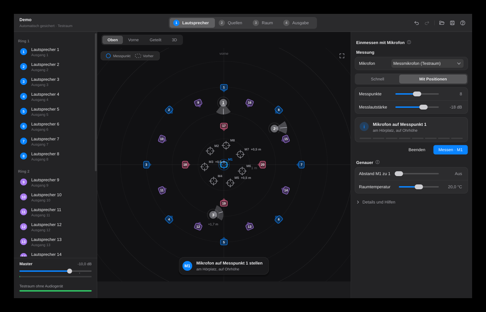

# Raumklang

Language: [Deutsch](README.md), English

Raumklang is a free tool for spatial audio on macOS and Windows. It places sound sources freely in space on any number of speakers, from a stereo pair through rings, domes and 7.1.4 to a *donut*, where two speaker rings face each other. It also has reverb, headphone playback (binaural, also with measured HRTFs from SOFA files) and two plugins for the DAW. An audio interface is all you need: the app talks to it directly, no extra routing software is required.


> Raumklang is an early version (0.1) and was [developed with AI](#developed-with-ai). It has been used in practice with twelve speakers in a ring. Bugs and gaps are possible, see [Features and limits](#features-and-limits). If it helps someone with their own project, I'm glad.

Download: [latest version for macOS (.dmg) and Windows (.zip)](https://github.com/BenjaminJMueller/immersive-audio-suite/releases/latest), plus the [installation notes](#installation).

## Background

Raumklang grew out of teaching. Seminars and installations work with multichannel setups that change from project to project: a ring in a seminar room, a dome, speakers around a central column. Students are meant to shape sound in space with them, usually without prior experience in multichannel audio and on their own computers.

A special case is the *donut*: two speaker rings facing each other, the inner one pointing outwards and the outer one pointing inwards, with the audience in between. Such a setup has no central listening spot, which is exactly what common methods like VBAP assume.

## Goals

In teaching, two hurdles stood out above all.

The first is routing through extra software. When the DAW sends its audio through a virtual audio device to a second program, a whole chain comes along: on macOS a loopback driver, often combined with a multi-output or aggregate device in *Audio MIDI Setup*, on Windows also an audio server or a driver wrapper, because an ASIO driver can only be opened by one program at a time. Every link of this chain has to be set up again on every computer, and when nothing is heard in the end, it is hard to find out where the chain breaks.

The second is usability. In seminars, students work on their own computers, with macOS and Windows, and usually without prior experience in multichannel audio. A session should start with sound in the room, not with setting up drivers. Speaker setup, sources and methods should live in one place, with feedback on whether a setup works.

This led to the requirements for this tool:

- stable: no crash during operation, not even with nonsensical input, faulty plugins or device changes, with automated tests on all systems
- no extra software: the app talks to the audio interface directly, the plugins work inside the DAW
- flexible speaker setups up to the donut, with understandable feedback on whether the layout works
- reverb and headphone playback in one place, so work is possible without speakers too
- runs on a normal computer under macOS and Windows, understandable for students without prior experience
- free and open source, no licence costs

## Workflow

The app leads from the speakers to the output in four steps.

### 1 Speakers

Pick a preset (stereo, quad, 5.1, 7.1.4, ring, dome, cube, donut) or place and drag speakers freely. Each speaker has a name, an output on the audio interface, position, orientation and level. In the sidebar, ⋯ or a right-click renames, duplicates, marks as subwoofer, disables or removes a speaker, and *+ Add speaker* puts another one on the circle. The 3D view shows every speaker as a box pointing in its radiation direction. Raumklang checks the layout and says in plain words whether it works and which method it uses. *Align delay and level* compensates delay and level when speakers stand at different distances.

### 2 Sources

Each source is an input of the audio interface, a track from the DAW or a built-in test signal (pink noise, sine, clicks). Sources are dragged in the top view or set with azimuth, elevation and distance, plus level, width, reverb send and distance effect. *Orbit* moves a source around the listening spot by itself. Every source has M (mute) and S (solo) in the sidebar.

### 3 Room

Reverb with room types (studio, chamber, hall, church, plate), chosen in the list on the left or under *Room type* on the right. The decay time can be dragged directly in the curve, separately for lows, mids and highs, plus room size, pre-delay and the levels of early reflections, cluster and tail. The time view below shows how the reverb builds up after the direct sound.

### 4 Output

Audio device, sample rate and buffer, master level, *Test speakers one by one* to check the wiring, and the routing of the speakers to the outputs. Before the limiter sits a 3D compressor: it controls all speakers together, so the spatial image stays intact.

*Listen on* offers three ways. *Speakers* gives every speaker its own output on the audio interface. *Headphones, system* renders the configured speakers binaurally into the headphones, each from its direction, for example to prepare a mix for the system without speakers. *Headphones, free* renders the sources binaurally around the head, independent of the layout. For both headphone ways, *HRTF* chooses between the built-in head model and a SOFA file with measured head-related transfer functions.

Below the room view sits the *Scenes* bar: it stores the whole mix and recalls it with a fade time, with arrows for the previous and next scene. The master with master level, meter and gain reduction is pinned at the bottom of the sidebar.

<p>
  
  
</p>

Projects are saved automatically, every step can be undone (⌘Z / Ctrl+Z). On first start a short introduction explains the four areas and offers to begin with a demo or your own setup; it can be shown again under *Help* (?). Every heading with (i) opens an explanation when clicked. If the audio device has fewer outputs than the layout has speakers, the demo switches on headphone playback by itself. The interface is in German, English can be selected under *Help* (?).

## Speaker calibration

Where the speakers really are can be measured in two ways. Both end in a preview: dashed the previous position, filled the measured one. *Apply* writes it into the layout, and *Undo* takes it back.

### With a microphone

In the *Speakers* step, *Calibrate with microphone* starts on the right under *Calibration*. A measuring microphone stands at ear height, each speaker plays a short sweep in turn. The delay gives the distance, the level gives the loudness. There are two modes:

- *Quick*: one measuring point. Delay and level are aligned there.
- *With positions*: 4 to 12 measuring points (default 8), alternating at ear height and 50 cm higher. Raumklang computes the position of every speaker from them (multilateration) and removes the latency of the audio interface by itself. In a donut not every point sees every speaker, so the measurement starts with 8 points there.

Raumklang shows where the microphone has to go next. A missing microphone, a silent speaker or a clipping input give a plain message instead of a wrong result. The measurement also detects swapped cables ("Swapped with A3?").

<p>
  
  
</p>

### With the iPhone

The app *Raumklang Messen* runs on an iPhone or iPad with LiDAR. First tap the listening spot, then the direction "front", then every speaker. The app measures the position and aim of every speaker. The file goes to the computer by AirDrop, mail or cloud. In Raumklang, *Load iPhone measurement* opens it, or drop it onto the window.

A web app cannot do this: Safari on the iPhone has no WebXR, so a web page reaches neither LiDAR nor ARKit's scene understanding. That is why *Raumklang Messen* is a small native app (`ios/RaumklangMessen`). To install it, build it with Xcode and a free Apple ID onto your own device, see [ios/README.md](ios/README.md).

Best use both together: the iPhone for position and aim, then the microphone in *Quick* mode for delay and level.

## In the DAW

There are two plugins, as VST3 and on the Mac also as AU for Logic Pro.

*Raumklang Quelle* (source) goes on every track. When the Raumklang app runs, the track appears there under *From the DAW*, and the app plays it through its audio interface, without any routing. Position, width, level, reverb send, mute and solo can be automated in the DAW, and whatever is changed on the track in the app is recorded by the DAW as automation. The plugin shows the room from above, from the front or in 3D, with the other tracks dimmed in the background. Without the app, the plugin outputs one channel per speaker; the track then needs as many channels as the layout has speakers.

The DAW's own mute and solo buttons do not reach a plugin, neither as AU nor as VST3, and since the audio leaves the track before the channel strip, they have no effect on the app. That is why *Raumklang Quelle* has its own M and S buttons at the top of its window. They apply to the track in the app and can be automated like any other parameter.

*Raumklang Return* brings the app's speaker signals back into the DAW, for recording and real-time bounces. In Logic for example on an aux in 7.1.4 for twelve speakers; with more speakers, further tracks take the rest.

The DAW and the app must run at the same sample rate. The plugins say so if they don't.

App and plugins share the speaker setup through a file in the user folder (`Raumklang/Lautsprecher-Setup.json`). A layout set up in the app is immediately available in the DAW, and all source plugins of a session always use the same room. The DAW project stores the layout too.

## Technical approach

### Methods

Three panning methods with automatic selection:

- *VBAP* (Pulkki 1997) for layouts that enclose the listening spot. 2D or 3D is detected. Incomplete domes get virtual speakers whose share is distributed to their neighbours. Width via MDAP.
- *DBAP* (Lossius 2009) for layouts without a central listening spot, extended by speaker orientation. A speaker pointing away from the source contributes less. This makes the donut work: inner ring facing out, outer ring facing in, the audience in between.
- *Ambisonics* up to 3rd order (ACN/SN3D) with an AllRAD decoder and max-rE weighting.

When a speaker is moved during playback, level, delay and panning glide to the new values, without a fade and without emptying the delay lines. Only when the setup itself changes (number of speakers, method) does the engine cross-fade briefly.

### Reverb

Early reflections (8 taps) and a dense reflection cluster (16 taps), followed by a feedback delay network with 16 lines, Hadamard feedback, input diffusion and frequency-dependent damping (separate decay time below 250 Hz). Each feedback loop has its own allpass and the lines are slowly modulated, so the tail becomes dense early and does not flutter on quiet material. Each speaker gets its own decorrelated mix.

### Headphones

There are two ways to choose from. The built-in head model is the structural model after Brown and Duda: interaural time difference, head shadow and pinna echoes that depend on direction and elevation, plus a gentle high-frequency cut from behind. It needs no measured data.

With a SOFA file (AES69, convention SimpleFreeFieldHRIR) Raumklang uses measured head-related transfer functions, for example of a dummy head or your own head. Every speaker, real or virtual, is convolved with the impulse responses of the nearest measured direction for both ears. The convolution runs block by block in the frequency domain (uniformly partitioned, overlap-save) and delays the headphones by 64 samples. Other sample rates in the file are converted when loading. The file is read with [libmysofa](https://github.com/hoene/libmysofa).

In *Headphones, free* mode the sources run through 19 virtual directions around the head.

### Directivity and Doppler effect

Every source has a directivity and an orientation. When it points away from the listening spot, the direct sound gets quieter (up to 12 dB) and duller, the reverb send stays the same. The Doppler effect can be switched on per source: the source is delayed by the sound travel time of its distance, so movement changes the pitch, by at most 10 %.

### Output stage

Before the limiter sits a 3D compressor. It measures the loudest output and lowers all speakers by the same amount, so the spatial image stays in place. Then a limiter caps every output at the set ceiling.

### Visualisation

Small sound particles glow between every playing source and its speakers. Their density shows how much energy each speaker receives from the source, depending on gain and level. The reverb appears in its own colour as a soft haze drifting from the sources to the speakers.

### Stability

The audio thread never allocates memory, locks or waits. Layout changes are prepared outside the audio thread and taken over without interruption. All input (including NaN and infinity from faulty plugins) is caught. Project files are written atomically and fully validated when loaded. SOFA files are loaded and checked outside the audio thread; an unusable file gives a message, and the head model plays until then.

### Tests

Every pull request and every change on `main` runs in CI:

- unit tests for geometry, all panning methods, reverb, headphone playback (head model and convolution with measured HRTFs) and engine
- a test proving the audio thread never allocates or frees memory
- stress tests with concurrent audio and UI threads, random layouts, block sizes, sample rates and nonsensical values
- the same tests under AddressSanitizer, UndefinedBehaviorSanitizer and ThreadSanitizer
- 5 minutes of fuzzing the engine with libFuzzer
- tests of the project file and of SOFA files with damaged and manipulated data
- a host stress test of both plugins (channel counts, automation from a second thread, damaged states, editors)
- [pluginval](https://github.com/Tracktion/pluginval) at strictness 10 on macOS, Windows and Linux

On top of that come listening tests on real setups, most recently with twelve speakers in a ring.

## Features and limits

| | |
|---|---|
| Speakers | up to 128 in the app, up to 64 per plugin track, freely placed, orientation, level, delay, output, subwoofer (100 Hz low-pass) |
| Presets | stereo, quad, 5.1, 7.1.4, ring (2 to 64), dome, cube, donut (inner/outer ring adjustable) |
| Sources | up to 64 in the app, audio interface inputs, DAW tracks or test signals, mono or stereo in the plugin |
| Methods | VBAP (2D/3D), DBAP with directivity, 3rd-order Ambisonics |
| Reverb | one shared room, FDN, presets and controls |
| Headphones | structural model or measured HRTFs from SOFA files |
| Output | directly to the audio device (Core Audio, WASAPI, ASIO when built with the SDK), routing, 3D compressor, limiter, speaker test |
| Languages | German (default), English |
| Systems | macOS 11 or later (Apple Silicon and Intel), Windows 10/11 64-bit, Linux |

Known limits:

- Without the app running, the plugins compute inside the DAW. DAWs without multichannel tracks (e.g. Ableton Live, Logic outside surround) then cannot pass the speaker channels on. With the app running, the app plays the tracks directly, which works in any DAW.
- The DAW's mute and solo do not affect tracks the app plays; the plugin has its own buttons for that (see [In the DAW](#in-the-daw)).
- Measured HRTFs are used without interpolation: every speaker gets the nearest measured direction. There is no head tracking.
- No OSC remote control, no Ambisonics inputs, no EQ in the speaker calibration yet (see roadmap).
- The microphone calibration measures position, delay and level, not the aim. The accuracy depends on the number and spacing of the measuring points. In a simulation of a ring with 3 m radius, 8 points are off by 4 cm on average and about 15 cm at most, with 5 points about twice as much. A measured distance (folding rule, laser) makes it more accurate. Raumklang shows the accuracy per speaker. The iPhone app has not been tried on a real device yet.
- The Mac app and plugins are not notarised by Apple. On first start use *System Settings → Privacy & Security → Open Anyway*, or run `xattr -dr com.apple.quarantine "/Applications/Raumklang.app"` in Terminal. On Windows, for SmartScreen click *More info → Run anyway*.

## Installation

On macOS (11 or later, Apple silicon and Intel) open `Raumklang-<version>-mac.dmg` and drag *Raumklang.app* to *Applications*. On first launch the app installs the plugins itself (AU for Logic and GarageBand, VST3, into your user folder); to reinstall use *Help → Install plugins*. The app is not notarised yet: on first launch use *System Settings → Privacy & Security → Open Anyway* (up to macOS 14: right-click → Open).

On Windows (10 or later) unzip `Raumklang-<version>-Windows.zip`, start *Raumklang.exe* and double-click *Plugins installieren.bat* (asks for administrator rights; the VST3 plugins go to `C:\Program Files\Common Files\VST3`). If SmartScreen says "Windows protected your PC": *More info → Run anyway*.

The DAW and the app must run at the same sample rate. Every change on `main` replaces the download with the newest version. The app checks for a new version once a day and, after asking, updates itself and the plugins (*Help → Check for updates*). Download and updates only work while the repository is public.

## Developed with AI

Raumklang was made with artificial intelligence. The code, tests and documentation were written by [Claude Code](https://claude.com/claude-code), an AI coding tool by Anthropic. The idea, the requirements from teaching, the directions for the technical implementation and the design of the interface come from me. I described what the tool should do and how it should be built, tried out intermediate versions, ran listening tests on real speaker setups and asked for changes.

Every change runs through the same automated tests (see [Technical approach](#technical-approach)) on macOS, Windows and Linux, and new versions are listened to on real setups, most recently with twelve speakers in a ring. Panning, reverb and headphone playback follow published methods (see [References](#references)). Changes made by the AI are marked as co-authored in the version history. If you find a bug or know a formula differently, please open an [issue](https://github.com/BenjaminJMueller/immersive-audio-suite/issues).

## References

- V. Pulkki: *Virtual Sound Source Positioning Using Vector Base Amplitude Panning*. J. Audio Eng. Soc. 45(6), 1997 (VBAP)
- V. Pulkki: *Uniform Spreading of Amplitude Panned Virtual Sources*. IEEE WASPAA, 1999 (MDAP)
- T. Lossius, P. Baltazar, T. de la Hogue: *DBAP – Distance-Based Amplitude Panning*. ICMC, 2009
- F. Zotter, M. Frank: *All-Round Ambisonic Panning and Decoding*. J. Audio Eng. Soc. 60(10), 2012 (AllRAD)
- J. Daniel: *Représentation de champs acoustiques, application à la transmission et à la reproduction de scènes sonores complexes dans un contexte multimédia*. PhD thesis, Université Paris 6, 2001 (max-rE)
- J.-M. Jot, A. Chaigne: *Digital Delay Networks for Designing Artificial Reverberators*. 90th AES Convention, 1991 (FDN)
- C. P. Brown, R. O. Duda: *A Structural Model for Binaural Sound Synthesis*. IEEE Trans. Speech and Audio Processing 6(5), 1998
- AES69-2022: *AES standard for file exchange, Spatial acoustic data file format* (SOFA)

## Building

Requirements: CMake 3.22 or later, a C++20 compiler (Xcode 15, Visual Studio 2022, GCC 12 or Clang 15). JUCE and libmysofa are fetched automatically during configuration.

```sh
cmake -S . -B build -DCMAKE_BUILD_TYPE=Release
cmake --build build --config Release
ctest --test-dir build -C Release
```

Engine and tests only, without JUCE: `-DRK_BUILD_APP=OFF -DRK_BUILD_PLUGINS=OFF`. With sanitizers: `-DRK_SANITIZE=address,undefined` or `-DRK_SANITIZE=thread`.

Layout:

| Folder | Contents |
|---|---|
| `core/` | Engine without dependencies: layouts, panning, reverb, headphone rendering, output stage |
| `shared/` | UI and project file, shared by app and plugins |
| `app/` | Standalone app |
| `plugins/` | *Raumklang Quelle* and *Raumklang Return* |
| `tests/` | Unit, stress and fuzz tests of the engine |

## License

Raumklang is licensed under the [GNU AGPLv3](LICENSE.md). It builds on [JUCE](https://juce.com), which is free to use for open-source projects under AGPLv3. Other components see [THIRD_PARTY_NOTICES.md](THIRD_PARTY_NOTICES.md).
