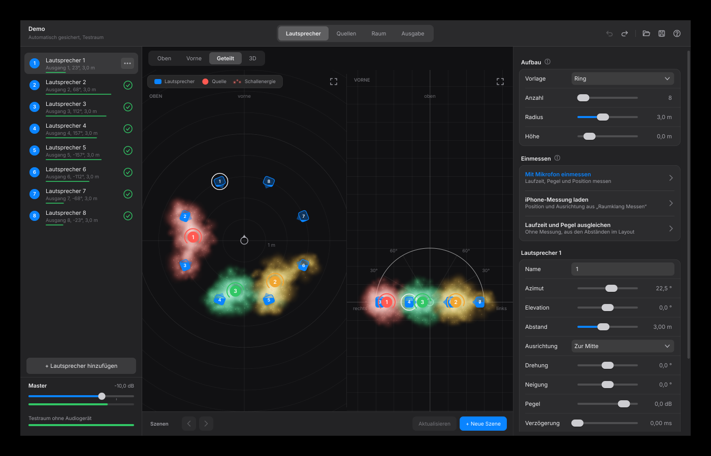
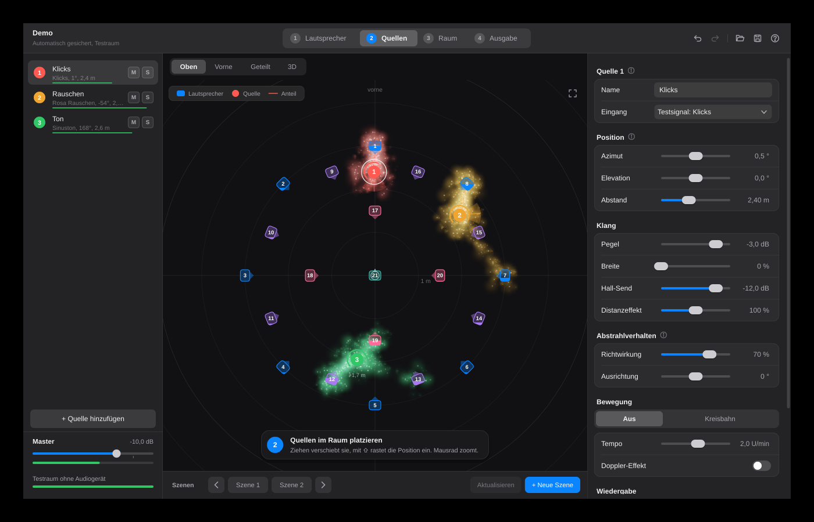
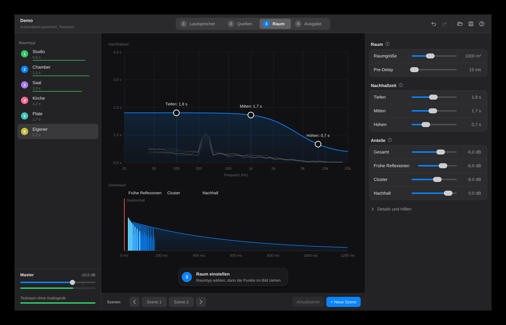

# Raumklang

[Deutsch](README.md) · English

Raumklang is a free tool for spatial audio on macOS and Windows. It places sound sources freely in space on any number of speakers, from a stereo pair through rings, domes and 7.1.4 to a *donut*, where two speaker rings face each other. It also has reverb, headphone playback (binaural) and two plugins for the DAW. An audio interface is all you need: the app talks to it directly, no extra routing software is required.



> **Early version (0.1).** Raumklang is new. The audio processing is extensively tested automatically, but hardly on real speaker setups yet. Bugs and gaps are likely, see [Features and limits](#features-and-limits). If it still helps someone with their own project, I'm glad.

**Download:** [macOS (.dmg)](https://github.com/BenjaminJMueller/immersive-audio-suite/releases/latest/download/Raumklang-mac.dmg) · [Windows (.zip)](https://github.com/BenjaminJMueller/immersive-audio-suite/releases/latest/download/Raumklang-Windows.zip) · [Installation notes](#installation)

## Background

Raumklang grew out of teaching. Seminars and installations work with multichannel setups that change from project to project: a ring in a seminar room, a dome, speakers around a central column. Students are meant to shape sound in space with them, usually without prior experience in multichannel audio and on their own computers.

A special case is the *donut*: two speaker rings facing each other, the inner one pointing outwards and the outer one pointing inwards, with the audience in between. Such a setup has no central listening spot, which is exactly what common methods like VBAP assume.

## Existing tools

There are a number of established tools for spatial audio, among them:

- **FLUX Spat Revolution** and **IRCAM Spat** as complete spatial audio environments
- **SpatGRIS / ControlGRIS** (Groupe de Recherche en Immersion Spatiale, Université de Montréal), free, with VBAP, MBAP, headphone output and DAW plugins
- **IEM Plug-in Suite** and **SPARTA** for Ambisonics in the DAW
- **d&b Soundscape**, **L-ISA** and **Holoplot** as systems from speaker manufacturers

## Why a new tool

None of these fitted teaching well. Spat Revolution can do everything needed, but costs a licence per seat and is a lot to take in for beginners. The manufacturers' systems are tied to their hardware. The Ambisonics suites are powerful but assume expert knowledge and do not cover setups without a central listening spot.

SpatGRIS comes closest and in principle offers the required features. In teaching, however, two hurdles stood out:

- **Routing through extra software.** The DAW does not send its audio to SpatGRIS directly but through a virtual audio device. On macOS that is BlackHole, often combined with a multi-output or aggregate device in *Audio MIDI Setup*. On Windows, JACK and ASIO4ALL come on top, because an ASIO driver can only be opened by one program at a time. JACK has to be installed separately, started with matching sample rate and buffer size, and has to run before the DAW and SpatGRIS. ASIO4ALL sits on top of the interface's drivers and behaves differently from device to device. Every link of this chain has to be set up again on every computer, and when nothing is heard in the end, it is hard to find out where the chain breaks.
- **Usability.** In seminars, students work on their own computers, with macOS and Windows, and usually without prior experience in multichannel audio. A session should start with sound in the room, not with setting up drivers. The SpatGRIS interface is hard to grasp for that: speaker setup, sources and methods are spread across several windows and programs, and there is little feedback on whether a setup works. Getting started therefore takes up a good part of the time meant for the creative work.

This led to the requirements for this tool:

- stable: no crash during operation, not even with nonsensical input, faulty plugins or device changes, with automated tests on all systems
- no extra software: the app talks to the audio interface directly, the plugins work inside the DAW
- flexible speaker setups up to the donut, with understandable feedback on whether the layout works
- reverb and headphone playback in one place, so work is possible without speakers too
- runs on a normal computer under macOS and Windows, understandable for students without prior experience
- free and open source, no licence costs

## Workflow

1. **Speakers.** Pick a preset (stereo, quad, 5.1, 7.1.4, ring, dome, cube, donut) or place and drag speakers freely. Raumklang checks the layout and says in plain words whether it works and which method it uses. *Align distances* compensates delay and level when speakers stand at different distances.
2. **Sources.** Each source is an input of the audio interface or a built-in test signal (pink noise, sine, clicks). Sources are dragged in the top view or set with azimuth, elevation and distance, plus level, width, reverb send and distance effect. *Orbit* moves a source around the listening spot by itself.
3. **Room.** Reverb with presets (dry, studio, hall, church) and controls for decay time, room size, high damping and pre-delay.
4. **Output.** Audio device, sample rate and buffer. Master level, limiter and *play speakers one by one* to check the wiring. Under *Listen on*, besides the speakers there are two headphone modes: *Headphones* plays your own speaker system in the headphones, *Binaural* places the sources freely around your head, independent of the speakers.

Below the room view sits the *Scenes* bar: it stores the whole mix and recalls it with a fade time, with arrows for the previous and next scene. Every source has M (mute) and S (solo) in the sidebar, and the output with master level and meter is pinned at the bottom.

<p>
  
  
</p>

Projects are saved automatically, every step can be undone (⌘Z / Ctrl+Z). On first start an introduction offers to begin with a demo. If the audio device has fewer outputs than the layout has speakers, the demo switches on headphone playback by itself. The interface is in German, English can be selected under *Help* (?).

## In the DAW

Two plugins (VST3, on the Mac also AU):

- **Raumklang Quelle** (source) goes on every track. It places the track in space and outputs one channel per speaker. Position, width, level and reverb send can be automated. The track needs as many channels as the layout has speakers (e.g. in Reaper, Nuendo/Cubase or Pro Tools Ultimate).
- **Raumklang Return** brings the app's speaker signals back into the DAW, for recording and real-time bounces.

App and plugins share the speaker setup through a file in the user folder (`Raumklang/Lautsprecher-Setup.json`). A layout set up in the app is immediately available in the DAW, and all source plugins of a session always use the same room. The DAW project stores the layout too.

## Technical approach

**Methods.** Three panning methods with automatic selection:

- *VBAP* (Pulkki 1997) for layouts that enclose the listening spot. 2D or 3D is detected. Incomplete domes get virtual speakers whose share is distributed to their neighbours. Width via MDAP.
- *DBAP* (Lossius 2009) for layouts without a central listening spot, extended by speaker orientation. A speaker pointing away from the source contributes less. This makes the **donut** work.
- *Ambisonics* up to 3rd order (ACN/SN3D) with an AllRAD decoder and max-rE weighting.

**Reverb.** Feedback delay network with 16 lines, Hadamard feedback, input diffusion and frequency-dependent damping. Each speaker gets its own decorrelated mix.

**Headphone preview.** Spherical head model after Brown and Duda: interaural time difference and head shadow per speaker, without measured HRTF data.

**Stability.** The audio thread never allocates memory, locks or waits. Layout changes are prepared outside the audio thread and taken over with a short fade. All input (including NaN and infinity from faulty plugins) is caught, a limiter keeps every output below −0.1 dBFS. Project files are written atomically and fully validated when loaded.

**Tests.** Every push runs in CI:

- unit tests for geometry, all panning methods, reverb, headphone playback and engine
- a test proving the audio thread never allocates or frees memory
- stress tests with concurrent audio and UI threads, random layouts, block sizes, sample rates and nonsensical values
- the same tests under AddressSanitizer, UndefinedBehaviorSanitizer and ThreadSanitizer
- 5 minutes of fuzzing the engine with libFuzzer
- tests of the project file with damaged and manipulated files
- a host stress test of both plugins (channel counts, automation from a second thread, damaged states, editors)
- [pluginval](https://github.com/Tracktion/pluginval) at strictness 10 on macOS, Windows and Linux

## Features and limits

| | |
|---|---|
| Speakers | up to 128 in the app, up to 64 per plugin track, freely placed, orientation, level, delay, subwoofer (100 Hz low-pass) |
| Presets | stereo, quad, 5.1, 7.1.4, ring (2 to 64), dome, cube, donut (inner/outer ring adjustable) |
| Sources | up to 64 in the app, audio interface inputs or test signals, mono or stereo in the plugin |
| Methods | VBAP (2D/3D), DBAP with directivity, 3rd-order Ambisonics |
| Reverb | one shared room, FDN, presets and controls |
| Output | directly to the audio device (Core Audio, WASAPI, ASIO when built with the SDK), headphones and binaural, speaker test, limiter |
| Languages | German (default), English |
| Systems | macOS 11 or later (Apple Silicon and Intel), Windows 10/11 64-bit, Linux |

Known limits:

- Not yet tried on real multichannel setups, only in tests and simulation.
- The plugins compute inside the DAW. DAWs without multichannel tracks (e.g. Ableton Live, Logic outside surround) cannot pass the speaker channels on. A direct connection from plugin to app is on the [roadmap](docs/ROADMAP.md).
- Layout changes during playback use a short fade (20 ms). This is audible when dragging speakers during playback.
- Headphone preview without individual HRTF, elevation is barely reproduced.
- No OSC remote control, no Ambisonics inputs, no EQ in the speaker calibration yet (see roadmap).
- Speaker calibration: with a measuring microphone (sweeps, multilateration over 4 to 12 points: position, delay and level) or with the iPhone app *Raumklang Messen* (LiDAR: position and aim), see the German README. The iPhone app has not been tried on a real device yet.
- The Mac app and plugins are not signed by Apple. On first start use *System Settings → Privacy & Security → Open Anyway*, or run `xattr -dr com.apple.quarantine "/Applications/Raumklang.app"` in Terminal. On Windows, for SmartScreen click *More info → Run anyway*.

## Installation

- **macOS (11 or later, Apple silicon and Intel):** open `Raumklang-mac.dmg`, drag *Raumklang.app* to *Applications* and double-click *Plugins installieren.command*. It copies the plugins (AU for Logic and GarageBand, VST3) into your user folder. The app is not notarised yet: on first launch use *System Settings → Privacy & Security → Open Anyway* (up to macOS 14: right-click → Open).
- **Windows (10 or later):** unzip `Raumklang-Windows.zip`, start *Raumklang.exe* and double-click *Plugins installieren.bat* (asks for administrator rights; the VST3 plugins go to `C:\Program Files\Common Files\VST3`). If SmartScreen says "Windows protected your PC": *More info → Run anyway*.

The DAW and the app must run at the same sample rate. Every change on `main` replaces the download with the newest version. The app checks for a new version once a day and, after asking, updates itself and the plugins (*Help → Check for updates*). This works once the repository is public.

## Building

Requirements: CMake 3.22 or later, a C++20 compiler (Xcode 15, Visual Studio 2022, GCC 12 or Clang 15). JUCE is fetched automatically during configuration.

```sh
cmake -S . -B build -DCMAKE_BUILD_TYPE=Release
cmake --build build --config Release
ctest --test-dir build -C Release
```

Engine and tests only, without JUCE: `-DRK_BUILD_APP=OFF -DRK_BUILD_PLUGINS=OFF`. With sanitizers: `-DRK_SANITIZE=address,undefined` or `-DRK_SANITIZE=thread`.

Layout:

| Folder | Contents |
|---|---|
| `core/` | Engine without dependencies: layouts, panning, reverb, headphone rendering, output stage |
| `shared/` | UI and project file, shared by app and plugins |
| `app/` | Standalone app |
| `plugins/` | *Raumklang Quelle* and *Raumklang Return* |
| `tests/` | Unit, stress and fuzz tests of the engine |

## License

Raumklang is licensed under the [GNU AGPLv3](LICENSE.md). It builds on [JUCE](https://juce.com), which is free to use for open-source projects under AGPLv3. Other components see [THIRD_PARTY_NOTICES.md](THIRD_PARTY_NOTICES.md).
