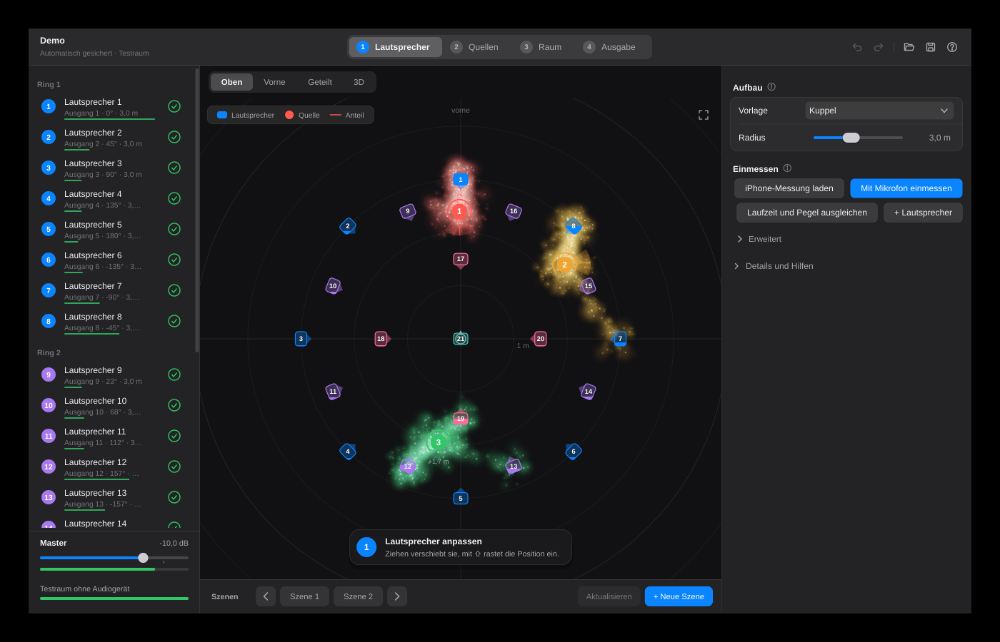
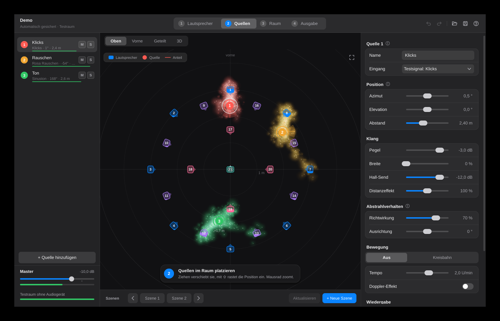
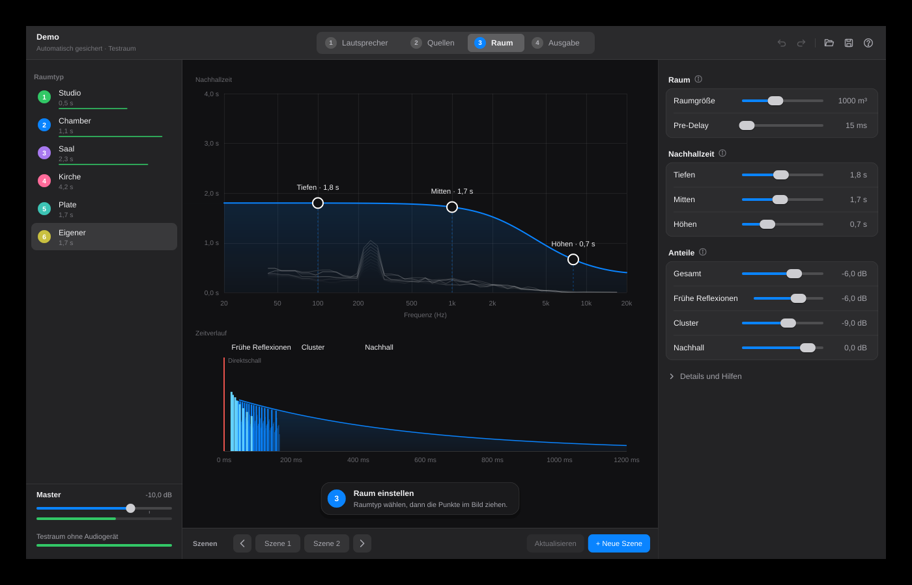
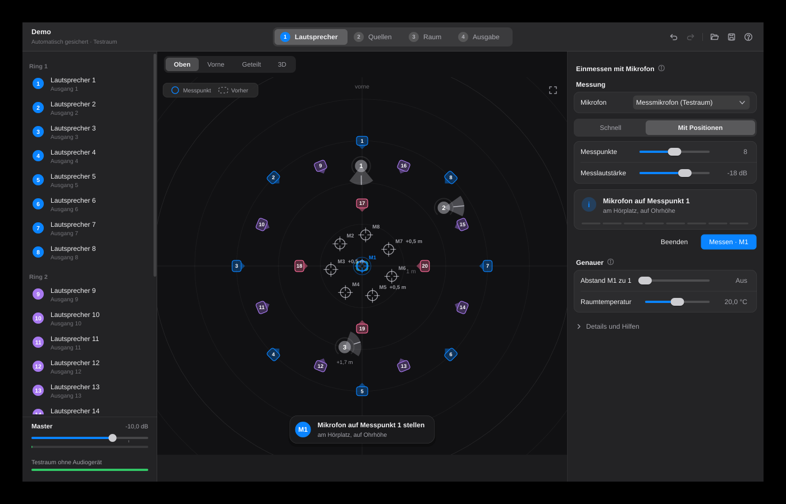
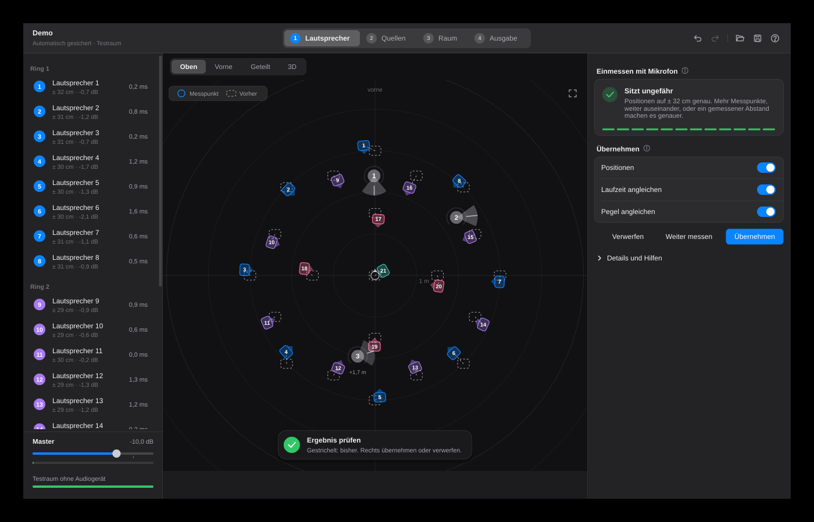

# Raumklang

Deutsch · [English](README.en.md)

Raumklang ist ein freies Werkzeug für räumlichen Klang auf macOS und Windows. Es verteilt Klangquellen frei im Raum auf beliebig viele Lautsprecher, vom Stereopaar über Ring, Kuppel und 7.1.4 bis zum *Donut*, bei dem sich zwei Lautsprecherringe gegenüberstehen. Dazu gibt es Hall, Kopfhörer-Wiedergabe (binaural) und zwei Plugins für die DAW. Ein Audio-Interface genügt: Die App spricht es direkt an, zusätzliche Programme für das Routing sind nicht nötig.



> **Frühe Version (0.1).** Raumklang ist neu. Die Klangberechnung ist ausführlich automatisch getestet, an echten Lautsprecheraufbauten aber noch kaum. Fehler und Lücken sind wahrscheinlich, siehe [Funktionsumfang und Grenzen](#funktionsumfang-und-grenzen). Raumklang ist [mit KI entwickelt](#mit-ki-entwickelt). Wenn es trotzdem jemandem bei einem eigenen Projekt weiterhilft, freue ich mich.

**Herunterladen:** [macOS (.dmg)](https://github.com/BenjaminJMueller/immersive-audio-suite/releases/latest/download/Raumklang-mac.dmg) · [Windows (.zip)](https://github.com/BenjaminJMueller/immersive-audio-suite/releases/latest/download/Raumklang-Windows.zip) · [Hinweise zur Installation](#installation)

## Hintergrund

Raumklang ist im Rahmen der Lehre entstanden. In Seminaren und Installationen wird mit Mehrkanal-Aufbauten gearbeitet, die sich von Projekt zu Projekt ändern: ein Ring im Seminarraum, eine Kuppel, Lautsprecher um eine Mittelsäule herum. Studierende sollen damit Klang im Raum gestalten, meist ohne Vorerfahrung in Mehrkanal-Technik und auf ihren eigenen Rechnern.

Eine Besonderheit ist der *Donut*: zwei Lautsprecherringe, die sich gegenüberstehen, ein innerer nach außen und ein äußerer nach innen gerichtet, das Publikum dazwischen. Ein solcher Aufbau hat keinen zentralen Hörplatz, gängige Verfahren wie VBAP gehen aber genau davon aus.

## Ziele

In der Lehre stellten sich vor allem zwei Hürden:

- **Routing über Zusatzprogramme.** Schickt die DAW ihren Ton über ein virtuelles Audiogerät an ein zweites Programm, kommt eine ganze Kette dazu: unter macOS etwa ein Loopback-Treiber, oft zusammen mit einem Gerät mit mehreren Ausgängen oder einem Aggregatgerät in *Audio-MIDI-Setup*, unter Windows zusätzlich ein Audio-Server oder ein Treiber-Wrapper, weil ein ASIO-Treiber nur von einem Programm zur Zeit geöffnet werden kann. Jedes dieser Glieder ist auf jedem Rechner neu einzurichten, und klingt es am Ende nicht, ist schwer herauszufinden, an welcher Stelle der Kette es hängt.
- **Bedienung.** In Seminaren arbeiten Studierende auf ihren eigenen Rechnern, mit macOS und Windows, und meist ohne Vorerfahrung in Mehrkanal-Technik. Eine Sitzung soll mit Klang im Raum beginnen, nicht mit der Einrichtung von Treibern. Lautsprecher-Setup, Quellen und Verfahren sollen an einem Ort liegen, mit einer Rückmeldung, ob ein Aufbau passt.

Daraus ergaben sich die Anforderungen an dieses Werkzeug:

- stabil: kein Absturz im Betrieb, auch nicht bei unsinnigen Eingaben, fehlerhaften Plugins oder Gerätewechseln, mit automatischen Tests auf allen Systemen
- keine Zusatzprogramme: die App spricht das Audio-Interface direkt an, die Plugins arbeiten in der DAW
- flexible Lautsprecher-Aufbauten bis zum Donut, mit einer verständlichen Rückmeldung, ob das Layout passt
- Hall und Kopfhörer-Wiedergabe an einem Ort, damit auch ohne Lautsprecher gearbeitet werden kann
- lauffähig auf einem normalen Rechner unter macOS und Windows, verständlich auch für Studierende ohne Vorerfahrung
- frei und quelloffen, ohne Lizenzkosten

## Arbeitsablauf

1. **Lautsprecher.** Vorlage wählen (Stereo, Quadrofonie, 5.1, 7.1.4, Ring, Kuppel, Würfel, Donut) oder Lautsprecher frei setzen und ziehen. Raumklang prüft das Layout und sagt in Klartext, ob es passt und welches Verfahren es nimmt. *Laufzeit und Pegel ausgleichen* gleicht Laufzeit und Pegel an, wenn Lautsprecher unterschiedlich weit weg stehen.
2. **Quellen.** Jede Quelle ist ein Eingang des Audio-Interfaces oder ein eingebautes Testsignal (rosa Rauschen, Sinuston, Klicks). Quellen werden in der Draufsicht gezogen oder über Azimut, Elevation und Abstand gesetzt, dazu Pegel, Breite, Hall-Send und Distanzeffekt. *Kreisbahn* bewegt eine Quelle von selbst um den Hörplatz.
3. **Raum.** Hall mit Raumtypen (Studio, Chamber, Saal, Kirche, Plate). Die Nachhallzeit lässt sich getrennt für Tiefen, Mitten und Höhen direkt in der Kurve ziehen, dazu Raumgröße, Pre-Delay und die Anteile von frühen Reflexionen, Cluster und Nachhall. Der Zeitverlauf darunter zeigt, wie der Hall nach dem Direktschall aufgebaut ist.
4. **Ausgabe.** Audiogerät, Abtastrate und Puffer wählen. Master-Pegel, Limiter und *Lautsprecher einzeln anspielen* zum Prüfen der Verkabelung. Unter *Hören über* gibt es neben den Lautsprechern zwei Kopfhörer-Arten: *Kopfhörer* spielt die eigene Lautsprecher-Anlage im Kopfhörer, *Binaural* stellt die Quellen frei um den Kopf, unabhängig von den Lautsprechern.

Unter der Raumansicht liegt die Leiste *Szenen*: Sie speichert den ganzen Mix und ruft ihn mit Überblendzeit wieder ab, mit Pfeilen für die vorherige und nächste Szene. Jede Quelle hat in der Seitenleiste M (stumm) und S (solo), unten steht fest der Master mit Master-Pegel und Pegelanzeige.

<p>
  
  
</p>

Projekte werden automatisch gesichert, alle Schritte lassen sich rückgängig machen (⌘Z / Strg+Z). Beim ersten Start bietet eine Einführung an, mit einer Demo zu beginnen. Hat das Audiogerät weniger Ausgänge als das Layout Lautsprecher, schaltet die Demo von selbst die Kopfhörer-Wiedergabe ein. Die Oberfläche ist auf Deutsch, Englisch lässt sich unter *Hilfe* (?) umstellen.

## Lautsprecher einmessen

Wo die Lautsprecher wirklich hängen, lässt sich auf zwei Wegen messen. Beide enden in einer Vorschau: gestrichelt die bisherige Position, ausgefüllt die gemessene. *Übernehmen* schreibt sie ins Layout, und *Rückgängig* nimmt das wieder zurück.

**Mit Mikrofon** (Schritt *Lautsprecher → Mit Mikrofon einmessen*). Ein Messmikrofon steht auf Ohrhöhe. Jeder Lautsprecher spielt nacheinander einen kurzen Gleitton. Aus der Laufzeit folgt der Abstand, aus dem Pegel die Lautstärke.

- *Schnell*: ein Messpunkt. Laufzeit und Pegel werden dort angeglichen.
- *Mit Positionen*: 4 bis 12 Messpunkte (Standard 8), abwechselnd auf Ohrhöhe und 50 cm höher. Raumklang berechnet daraus die Position jedes Lautsprechers (Multilateration) und rechnet die Verzögerung des Audio-Interfaces von selbst heraus. Beim Donut sieht nicht jeder Punkt jeden Lautsprecher, deshalb beginnt die Messung dort mit 8 Punkten.

Raumklang zeigt, wo das Mikrofon als Nächstes hin muss. Ein fehlendes Mikrofon, ein stummer Lautsprecher oder ein übersteuerter Eingang ergeben eine Meldung in Klartext statt eines falschen Ergebnisses. Vertauschte Kabel erkennt die Messung ebenfalls („Vertauscht mit A3?“).

<p>
  
  
</p>

**Mit dem iPhone** (App *Raumklang Messen*, ein iPhone oder iPad mit LiDAR). Zuerst den Hörplatz antippen, dann die Richtung „vorne“, dann jeden Lautsprecher. Die App misst Position und Ausrichtung jedes Lautsprechers. Die Datei kommt per AirDrop, Mail oder Cloud auf den Rechner. In Raumklang lädt sie *iPhone-Messung laden*, oder sie wird einfach auf das Fenster gezogen.

Eine Web-App kann das nicht: Safari auf dem iPhone bietet kein WebXR, eine Webseite kommt also weder an LiDAR noch an die Raumerfassung von ARKit. Deshalb ist *Raumklang Messen* eine kleine native App (`ios/RaumklangMessen`). Zum Installieren mit Xcode und einer kostenlosen Apple-ID auf das eigene Gerät spielen, siehe [ios/README.md](ios/README.md).

Am besten beide Wege zusammen: das iPhone für Position und Ausrichtung, danach das Mikrofon im Modus *Schnell* für Laufzeit und Pegel.

## In der DAW

Zwei Plugins (VST3, auf dem Mac zusätzlich AU für Logic Pro):

- **Raumklang Quelle** kommt auf jede Spur. Läuft die Raumklang-App, erscheint die Spur dort unter *Aus der DAW* und die App spielt sie über ihr Audio-Interface, ganz ohne Routing. Position, Breite, Pegel und Hall-Send sind in der DAW automatisierbar, die App zeigt die Spur mit und übernimmt jede Bewegung. Das Plugin zeigt den Raum von oben, von vorne oder in 3D, mit den anderen Spuren blass im Hintergrund. Ohne App gibt das Plugin einen Kanal pro Lautsprecher aus; die Spur braucht dann so viele Kanäle wie das Layout Lautsprecher.
- **Raumklang Return** (der Rückweg) holt die Lautsprechersignale der App zurück in die DAW, zum Aufnehmen und für Bounces in Echtzeit. In Logic etwa auf einem Aux in 7.1.4 für zwölf Lautsprecher; bei mehr Lautsprechern übernehmen weitere Spuren den Rest.

DAW und App müssen mit derselben Abtastrate laufen. Die Plugins sagen es, wenn nicht.

Das Lautsprecher-Setup teilen sich App und Plugins über eine Datei im Benutzerordner (`Raumklang/Lautsprecher-Setup.json`). Ein in der App eingerichtetes Layout steht damit sofort in der DAW bereit, und alle Quellen-Plugins einer Sitzung verwenden immer denselben Raum. Das DAW-Projekt speichert das Layout mit.

## Technischer Ansatz

**Verfahren.** Drei Panning-Verfahren mit automatischer Auswahl:

- *VBAP* (Pulkki 1997) für Layouts, die den Hörplatz umschließen. 2D oder 3D wird selbst erkannt. Für unvollständige Kuppeln werden virtuelle Lautsprecher ergänzt, deren Anteil auf die Nachbarn verteilt wird. Breite über MDAP.
- *DBAP* (Lossius 2009) für Layouts ohne zentralen Hörplatz, erweitert um die Ausrichtung der Lautsprecher. Ein Lautsprecher, der von der Quelle wegzeigt, trägt weniger bei. Damit funktioniert der **Donut**: Innenring nach außen, Außenring nach innen, das Publikum dazwischen.
- *Ambisonics* bis 3. Ordnung (ACN/SN3D) mit AllRAD-Decoder und max-rE-Gewichtung.

**Hall.** Frühe Reflexionen (8 Abgriffe) und ein dichter Reflexions-Cluster (16 Abgriffe), danach ein Feedback Delay Network mit 16 Leitungen, Hadamard-Rückkopplung, Eingangsdiffusion und frequenzabhängiger Dämpfung (getrennte Nachhallzeit unterhalb von 250 Hz). Jeder Lautsprecher bekommt eine eigene, dekorrelierte Mischung.

**Kopfhörer.** Strukturmodell nach Brown und Duda: interauraler Laufzeitunterschied, Kopfschatten und Ohrmuschel-Echos, die von Richtung und Höhe abhängen, dazu eine sanfte Höhenabsenkung von hinten. Ohne gemessene HRTF-Daten. Im Modus *Binaural* laufen die Quellen über 19 virtuelle Richtungen um den Kopf.

**Abstrahlverhalten.** Jede Quelle hat eine Richtwirkung und eine Ausrichtung. Zeigt sie vom Hörplatz weg, wird der Direktschall leiser (bis 12 dB) und dumpfer, der Hall-Send bleibt gleich.

**Doppler-Effekt.** Zuschaltbar je Quelle. Die Quelle wird um die Schalllaufzeit ihres Abstands verzögert, sodass sich bei Bewegung die Tonhöhe ändert, höchstens um 10 %.

**Visualisierung.** Zwischen jeder klingenden Quelle und ihren Lautsprechern leuchten kleine Schallteilchen. Ihre Dichte zeigt, wie viel Energie jeder Lautsprecher von der Quelle bekommt, abhängig von Verstärkung und Pegel.

**Stabilität.** Der Audio-Thread reserviert keinen Speicher, sperrt nichts und wartet auf nichts. Layoutwechsel werden außerhalb des Audio-Threads vorbereitet und mit kurzer Blende übernommen. Alle Eingaben (auch NaN und Unendlich aus fehlerhaften Plugins) werden abgefangen, ein Limiter begrenzt jeden Ausgang auf −0,1 dBFS. Projektdateien werden atomar geschrieben und beim Laden vollständig geprüft.

**Tests.** Bei jedem Pull Request und jedem Stand auf `main` laufen in der CI:

- Unit-Tests für Geometrie, alle Panning-Verfahren, Hall, Kopfhörer-Wiedergabe und Engine
- ein Test, der beweist, dass der Audio-Thread nie Speicher reserviert oder freigibt
- Stresstests mit gleichzeitigem Audio- und Bedien-Thread, zufälligen Layouts, Blockgrößen, Abtastraten und unsinnigen Werten
- dieselben Tests unter AddressSanitizer, UndefinedBehaviorSanitizer und ThreadSanitizer
- 5 Minuten Fuzzing der Engine mit libFuzzer
- Tests der Projektdatei mit beschädigten und manipulierten Dateien
- ein Host-Stresstest beider Plugins (Kanalzahlen, Automation aus einem zweiten Thread, beschädigte Zustände, Editoren)
- [pluginval](https://github.com/Tracktion/pluginval) mit Strenge 10 auf macOS, Windows und Linux

## Funktionsumfang und Grenzen

| | |
|---|---|
| Lautsprecher | bis 128 in der App, bis 64 je Plugin-Spur, frei platzierbar, Ausrichtung, Pegel, Verzögerung, Subwoofer (Tiefpass 100 Hz) |
| Vorlagen | Stereo, Quadrofonie, 5.1, 7.1.4, Ring (2 bis 64), Kuppel, Würfel, Donut (Innen-/Außenring frei) |
| Quellen | bis 64 in der App, Eingänge des Audio-Interfaces oder Testsignale, mono oder stereo im Plugin |
| Verfahren | VBAP (2D/3D), DBAP mit Richtwirkung, Ambisonics 3. Ordnung |
| Hall | ein gemeinsamer Raum, FDN, Vorlagen und Regler |
| Ausgabe | direkt auf das Audiogerät (Core Audio, WASAPI, ASIO wenn mit SDK gebaut), Kopfhörer und Binaural, Lautsprechertest, Limiter |
| Sprachen | Deutsch (Standard), Englisch |
| Systeme | macOS 11 oder neuer (Apple Silicon und Intel), Windows 10/11 64 Bit, Linux |

Bekannte Grenzen:

- Noch nicht an echten Mehrkanal-Aufbauten erprobt, nur in Tests und Simulation.
- Ohne laufende App rechnen die Plugins in der DAW. DAWs ohne Mehrkanal-Spuren (z. B. Ableton Live, Logic außerhalb von Surround) können die Lautsprecherkanäle dann nicht weiterreichen. Mit laufender App spielt die App die Spuren direkt, das geht in jeder DAW.
- Bei Layoutwechseln während der Wiedergabe gibt es eine kurze Blende (20 ms). Beim Ziehen von Lautsprechern während der Wiedergabe ist das hörbar.
- Kopfhörer ohne individuelle HRTF: Vorne, hinten und Höhe sind über ein Modell angedeutet, nicht gemessen.
- Keine OSC-Fernsteuerung, keine Ambisonics-Eingänge, keine Entzerrung (EQ) beim Einmessen (siehe Roadmap).
- Das Einmessen mit Mikrofon misst Position, Laufzeit und Pegel, nicht die Ausrichtung. Die Genauigkeit hängt von Zahl und Abstand der Messpunkte ab. In der Simulation eines Rings mit 3 m Radius liegen 8 Messpunkte im Mittel 4 cm daneben, höchstens etwa 15 cm, mit 5 Punkten etwa doppelt so viel. Ein gemessener Abstand (Zollstock, Laser) macht es genauer. Raumklang zeigt die Genauigkeit je Lautsprecher an. Die iPhone-App ist noch nicht auf einem echten Gerät erprobt.
- Mac-App und Plugins sind nicht von Apple signiert. Beim ersten Start *Systemeinstellungen → Datenschutz & Sicherheit → Dennoch öffnen*, oder im Terminal `xattr -dr com.apple.quarantine "/Applications/Raumklang.app"`. Unter Windows bei SmartScreen *Weitere Informationen → Trotzdem ausführen*.

## Installation

- **macOS (ab 11, Apple Silicon und Intel):** `Raumklang-mac.dmg` öffnen, *Raumklang.app* in *Programme* ziehen und *Plugins installieren.command* doppelklicken. Es kopiert die Plugins (AU für Logic und GarageBand, VST3) in den Benutzerordner. Die App ist noch nicht von Apple beglaubigt: Beim ersten Start *Systemeinstellungen → Datenschutz & Sicherheit → Dennoch öffnen* (bis macOS 14: Rechtsklick → Öffnen).
- **Windows (ab 10):** `Raumklang-Windows.zip` entpacken, *Raumklang.exe* starten und *Plugins installieren.bat* doppelklicken (fragt nach Administratorrechten, die VST3-Plugins kommen nach `C:\Program Files\Common Files\VST3`). Meldet SmartScreen „Der Computer wurde durch Windows geschützt“: *Weitere Informationen → Trotzdem ausführen*.

DAW und App müssen mit derselben Abtastrate laufen. Jeder Stand auf `main` ersetzt den Download durch die neueste Version. Die App sucht einmal am Tag selbst nach einer neuen Version und aktualisiert sich samt Plugins nach Rückfrage (*Hilfe → Nach Updates suchen*). Download und Update funktionieren nur, solange das Repository öffentlich ist.

## Mit KI entwickelt

Raumklang ist mit künstlicher Intelligenz entstanden. Programmcode, Tests und Dokumentation hat [Claude Code](https://claude.com/claude-code) geschrieben, ein KI-Programmierwerkzeug von Anthropic. Von mir kommen die Idee, die Anforderungen aus der Lehre und die Gestaltung der Bedienung: Ich habe beschrieben, was das Werkzeug können soll, Zwischenstände ausprobiert und Änderungen angefordert.

Was das bedeutet:

- **Geprüft durch Tests, nicht durch Praxis.** Jede Änderung läuft durch dieselben automatischen Tests (siehe [Technischer Ansatz](#technischer-ansatz)), auf macOS, Windows und Linux. Die Tests prüfen Rechenregeln und Stabilität, ersetzen aber keinen Einsatz an echten Lautsprechern.
- **Verfahren aus der Fachliteratur.** Panning, Hall und Kopfhörer-Wiedergabe folgen veröffentlichten Verfahren (siehe [Literatur](#literatur)). Die Umsetzung hat bisher keine Fachperson Zeile für Zeile geprüft.
- **Nachvollziehbar.** Änderungen der KI sind in der Versionsgeschichte als Co-Autor gekennzeichnet.
- **Rückmeldungen willkommen.** Wer einen Fehler findet oder eine Formel anders kennt, schreibt am besten ein [Issue](https://github.com/BenjaminJMueller/immersive-audio-suite/issues).

## Literatur

- V. Pulkki: *Virtual Sound Source Positioning Using Vector Base Amplitude Panning*. J. Audio Eng. Soc. 45(6), 1997 (VBAP)
- V. Pulkki: *Uniform Spreading of Amplitude Panned Virtual Sources*. IEEE WASPAA, 1999 (MDAP)
- T. Lossius, P. Baltazar, T. de la Hogue: *DBAP – Distance-Based Amplitude Panning*. ICMC, 2009
- F. Zotter, M. Frank: *All-Round Ambisonic Panning and Decoding*. J. Audio Eng. Soc. 60(10), 2012 (AllRAD)
- J. Daniel: *Représentation de champs acoustiques, application à la transmission et à la reproduction de scènes sonores complexes dans un contexte multimédia*. Dissertation, Université Paris 6, 2001 (max-rE)
- J.-M. Jot, A. Chaigne: *Digital Delay Networks for Designing Artificial Reverberators*. 90th AES Convention, 1991 (FDN)
- C. P. Brown, R. O. Duda: *A Structural Model for Binaural Sound Synthesis*. IEEE Trans. Speech and Audio Processing 6(5), 1998

## Selbst bauen

Voraussetzungen: CMake 3.22 oder neuer, ein C++20-Compiler (Xcode 15, Visual Studio 2022, GCC 12 oder Clang 15). JUCE wird beim Konfigurieren automatisch geladen.

```sh
cmake -S . -B build -DCMAKE_BUILD_TYPE=Release
cmake --build build --config Release
ctest --test-dir build -C Release
```

Nur die Engine mit Tests, ohne JUCE: `-DRK_BUILD_APP=OFF -DRK_BUILD_PLUGINS=OFF`. Mit Sanitizern: `-DRK_SANITIZE=address,undefined` oder `-DRK_SANITIZE=thread`.

Aufbau:

| Ordner | Inhalt |
|---|---|
| `core/` | Engine ohne Abhängigkeiten: Layouts, Panning, Hall, Kopfhörer-Wiedergabe, Ausgangsstufe |
| `shared/` | Oberfläche und Projektdatei, gemeinsam für App und Plugins |
| `app/` | Standalone-App |
| `plugins/` | *Raumklang Quelle* und *Raumklang Return* |
| `tests/` | Unit-, Stress- und Fuzz-Tests der Engine |

## Lizenz

Raumklang steht unter der [GNU AGPLv3](LICENSE.md). Es baut auf [JUCE](https://juce.com) auf, das für Open-Source-Projekte unter AGPLv3 frei nutzbar ist. Weitere Bestandteile siehe [THIRD_PARTY_NOTICES.md](THIRD_PARTY_NOTICES.md).
